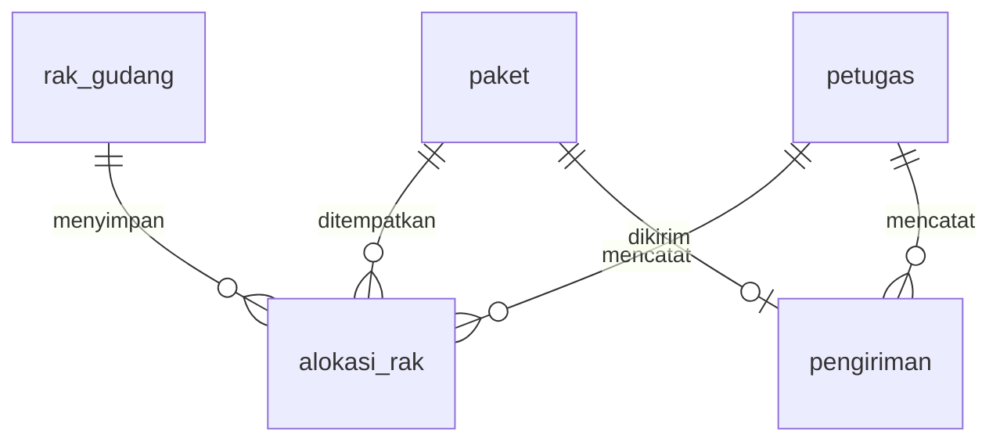

# Ruang Gudang

Prototipe aplikasi pengelolaan logistik gudang dengan PHP dan database relasional. Proyek ini mendemonstrasikan pencatatan paket, penempatan rak, pengiriman, dan pelaporan dalam satu alur kerja.

[Buka demo](https://ruang-gudang.vercel.app)

> Demo portofolio tanpa autentikasi. Pengunjung dapat mengubah data melalui aplikasi. Gunakan data fiktif; aplikasi belum ditujukan untuk operasional publik atau penyimpanan data pribadi.

## Fitur

- **Ringkasan:** jumlah paket menurut status, pekerjaan berikutnya, kapasitas rak, aktivitas terbaru, serta grafik yang dapat dibuka saat diperlukan.
- **Paket:** tambah, cari, filter, edit, dan lihat riwayat paket.
- **Penempatan:** alokasikan paket ke rak atau pindahkan paket dengan riwayat tetap tersimpan.
- **Pengiriman:** tandai siap kirim, catat kurir dan kendaraan, lalu konfirmasi kedatangan.
- **Rak Gudang:** kelola zona dan kapasitas, lihat sisa ruang serta paket yang tersimpan.
- **Petugas:** kelola nama, peran, dan nomor telepon penanggung jawab transaksi.
- **Laporan:** filter periode dan ekspor aktivitas ke CSV.

## Teknologi

| Bagian | Teknologi |
|---|---|
| Backend | PHP 8.1+, PDO, template HTML |
| Antarmuka | CSS responsif, JavaScript tanpa proses build |
| Database lokal | MySQL/MariaDB dengan InnoDB |
| Database demo | PostgreSQL di Neon |
| Hosting demo | Vercel, runtime komunitas `vercel-php@0.9.0` |

## Menjalankan secara lokal

Persyaratan: PHP 8.1+ dengan `pdo_mysql` dan `mbstring`, serta MySQL/MariaDB. XAMPP dapat digunakan pada Windows.

1. Clone repository dan masuk ke direktori proyek.

   ```powershell
   git clone https://github.com/HanzelBro/ruang-gudang.git
   cd ruang-gudang
   ```

2. Aktifkan MySQL. Buat database kosong bernama `db_logistik_gudang` dengan charset `utf8mb4` melalui phpMyAdmin atau klien MySQL.
3. Pilih database tersebut, lalu impor `database/mysql.sql`. File ini hanya berisi struktur tabel dan trigger. Jangan mengimpornya ke database yang sudah berisi data.
4. Sesuaikan koneksi melalui variabel lingkungan atau `config.php`. Bawaan lokal: `127.0.0.1:3306`, database `db_logistik_gudang`, pengguna `root`, password kosong.
5. Jalankan server dari direktori proyek:

   ```powershell
   powershell -ExecutionPolicy Bypass -File .\start.ps1
   ```

6. Buka `http://localhost:8080`. Untuk PHP yang tersedia di PATH, alternatifnya:

   ```shell
   php -S 127.0.0.1:8080 router.php
   ```

Database baru dimulai tanpa data. Tambahkan petugas dan rak melalui aplikasi, lalu catat paket pertama. Aplikasi tidak mereset atau mengisi ulang database secara otomatis.

Apache XAMPP juga didukung. Letakkan proyek di direktori web dan akses melalui localhost; aturan `.htaccess` membatasi akses langsung ke konfigurasi, SQL, dan implementasi internal.

## Konfigurasi koneksi

| Variabel | Kegunaan |
|---|---|
| `RG_DB_HOST` | Host MySQL, bawaan `127.0.0.1` |
| `RG_DB_PORT` | Port MySQL, bawaan `3306` |
| `RG_DB_NAME` | Nama database, bawaan `db_logistik_gudang` |
| `RG_DB_USER` | Pengguna MySQL, bawaan `root` |
| `RG_DB_PASSWORD` | Password MySQL |
| `DATABASE_URL_UNPOOLED` | URL PostgreSQL; diutamakan bila tersedia |
| `DATABASE_URL` | URL PostgreSQL cadangan |

Aplikasi membaca variabel lingkungan proses. File `.env` tidak dimuat otomatis. Simpan kredensial pada environment server atau pengelola environment hosting; jangan commit kredensial ke Git. Tanpa URL PostgreSQL, aplikasi memilih MySQL lokal. Zona waktu aplikasi adalah Asia/Jakarta.

## Struktur database

Lima tabel bisnis menyimpan data operasional. PostgreSQL juga menggunakan schema `app_runtime` untuk session, terpisah dari tabel bisnis.



Status paket: `Diterima`, `Tersimpan`, `Siap Kirim`, lalu `Terkirim`. Status paket `Terkirim` berarti sudah keluar dari gudang. Status pengiriman mencatat apakah paket masih dalam perjalanan atau sudah tiba.

## Integritas data

- Prepared statements, escaping keluaran, token CSRF, dan validasi server melindungi jalur formulir aplikasi.
- Transaksi dan penguncian baris digunakan untuk memeriksa alokasi, pengiriman berulang, serta batas kapasitas rak.
- Trigger `trg_after_alokasi_rak_insert` dan `trg_after_pengiriman_insert` memperbarui kapasitas serta status saat penempatan dan pengiriman.
- Pemindahan menutup alokasi lama dan membuat alokasi baru dalam satu transaksi.
- Nomor resi tetap setelah dibuat. Berat tidak dapat diubah setelah paket memiliki riwayat transaksi.
- Penghapusan data berelasi dan penurunan kapasitas di bawah beban terpakai ditolak.
- Ketidaksesuaian kapasitas dengan alokasi aktif ditolak tanpa memperbaiki data lama secara otomatis.

Periode laporan menggunakan waktu penempatan dan pengiriman yang tersedia. Penempatan menghitung pemindahan antarrak; aplikasi tidak mengarang tanggal penerimaan paket.

## Deployment Vercel dan Neon

1. Buat proyek Vercel dari repository ini dan hubungkan database Neon.
2. Pada database PostgreSQL kosong, jalankan `database/postgres.sql`, lalu `database/postgres-triggers.sql`.
3. Pastikan `DATABASE_URL_UNPOOLED` atau `DATABASE_URL` tersedia pada environment deployment. Runtime memerlukan `pdo_pgsql`.
4. Deploy menggunakan konfigurasi `vercel.json` yang disertakan. Entry point `api/index.php` menjalankan aplikasi yang sama.

`DATABASE_URL_UNPOOLED` diutamakan untuk PDO. Koneksi PostgreSQL menggunakan TLS dan opsi endpoint Neon untuk kompatibilitas runtime. Session PostgreSQL disimpan di database dengan masa berlaku dua jam; cookie deployment memakai Secure, HttpOnly, dan SameSite=Lax.

`scripts/migrate-cloud.php` tersedia untuk pemindahan manual dari MySQL ke PostgreSQL. Script hanya berjalan melalui CLI, membutuhkan path backup di luar direktori publik, dan menolak tujuan yang sudah memiliki tabel. Saat impor data lama, trigger dipasang setelah impor agar kapasitas tidak dihitung dua kali. Jangan menjalankan migrasi ulang pada database produksi.

## Struktur proyek

```text
api/        Entry point Vercel
app/        Koneksi, transaksi, session, template, dan halaman
assets/     CSS, JavaScript, dan favicon
database/   Skema MySQL/PostgreSQL dan trigger tanpa data pengguna
scripts/    Migrasi database melalui CLI
config.php  Konfigurasi berbasis environment
index.php   Routing halaman dan penanganan formulir
router.php  Pembatasan rute server PHP lokal
start.ps1   Peluncur lokal Windows
vercel.json Konfigurasi deployment
```

## Batasan

Prototipe ini belum memiliki login, pembatasan akses berdasarkan peran, integrasi kurir, atau backup terjadwal. Pemilihan petugas mencatat penanggung jawab, bukan memverifikasi identitas pengunjung. Tidak ada klaim audit keamanan menyeluruh atau pengujian beban produksi.

Cadangkan database sebelum mengubah struktur atau memigrasikan data. Gunakan database terpisah untuk mencoba perubahan data dan pengujian rollback.
